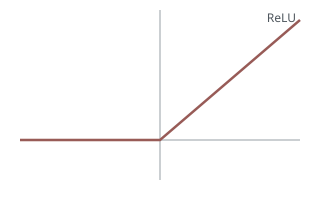
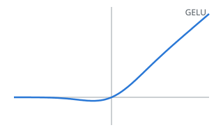
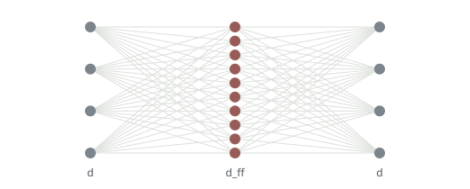
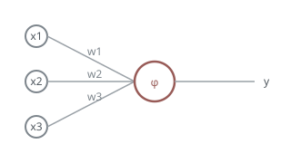

这篇文章列出 Bake 的全部写法。每种写法放在一个 `:::example` 块里，页面上同时显示 Markdown 原文和它生成的样子。新增或修改写法时，先改这篇文章。

:::example 块的写法是：

````markdown
:::example
**粗体**和 ==重点标记==。
:::
````

`:::example` 和 `:::` 之间的原文只写一次。页面上原文和效果左右并排，放不下时原文在上、效果在下。效果一侧按正文的规则生成，有三点不同：示例里的标题不进入目录，也不参与章节编号；`:::recap` 的要点直接显示出来，样子和目录里相同；示例里的旁注、参考文献和公式编号和正文一起编号。示例里还有 `:::` 块时，外层的冒号要比内层多。

## 文章开头的 front matter {#front-matter toc="front matter"}

每篇文章是 `content/posts/` 下的一个文件夹，文件夹里的 `index.md` 以 front matter 开头。这篇文章的 front matter 是：

```markdown
---
title: Bake 写法一览
slug: syntax
date: 2026-10-19
summary: Bake 支持的全部 Markdown 写法，每种写法同时给出原文和生成的样子。
tags: [Bake, 写法]
category: writing
toc: notes
---
```

网址由 `date` 的年月和 `slug` 组成，这篇文章的网址是 `/2026-10/syntax/`。文件夹放在 `content/posts/` 下的哪一层都可以，网址不受影响。全部字段如下：

| 字段 | 必填 | 含义 |
|---|---|---|
| `title` | 是 | 文章标题。 |
| `slug` | 是 | 网址的最后一段，只能用小写字母、数字和 `-`。 |
| `date` | 是 | 写作日期，格式 `YYYY-MM-DD`，年月进入网址。 |
| `summary` | 否 | 一句摘要，用于页头导语、首页卡片、网页描述和 RSS。 |
| `category` | 站点配置了分类时必填 | 分类的 id，取自 `bake.config.js` 的 `categories`。 |
| `tags` | 否 | 标签列表，用于首页筛选。 |
| `preview` | 否 | 首页卡片的动画预览脚本，放在文章文件夹里。 |
| `cover` | 否 | 分享图片，不写时由 Bake 生成。 |
| `theme` | 否 | 主题，`essay` 或 `bento`，不写时用站点默认值。 |
| `toc` | 否 | essay 主题的选项，目录样式：`notes`、`tabs`、`dots`、`ticks`，分别是 T1 前文笔记、T2 书签索引、T3 圆点胶囊、T4 刻度线，不写时用 `bake.config.js` 里 `themes.essay.toc` 的值。front matter 可以写文章所用主题的任何选项，例如 bento 文章的 `columns`。 |
| `draft` | 否 | 写 `true` 时不发布，只在 `bake dev` 里显示。 |
| `page` | 否 | 纯 HTML 页面要原样发布的文件，写了它的 `index.md` 没有正文。 |

`preview` 指向的脚本是一个 ES 模块。它的默认导出是一个函数：函数收到一个覆盖卡片预览区的空元素，在里面画出第一帧，然后返回带 `start` 和 `stop` 两个方法的对象。首页在卡片接近屏幕时加载这个脚本；指针停在卡片上时调用 `start`，指针离开时调用 `stop`；手机上卡片滚到屏幕中间时开始，离开中间时停止；读者要求减少动画时只显示第一帧。颜色用主题的 CSS 变量，深色模式下随之改变。

```js
export default function preview(element) {
  element.innerHTML = '<svg viewBox="0 0 320 180"><circle cx="160" cy="90" r="40" fill="var(--series-1)"/></svg>';
  let frame = 0;
  return {
    start() {
      const step = (time) => {
        element.querySelector('circle').setAttribute('cx', 160 + 100 * Math.sin(time / 600));
        frame = requestAnimationFrame(step);
      };
      frame = requestAnimationFrame(step);
    },
    stop() {
      cancelAnimationFrame(frame);
    },
  };
}
```

没有 `preview` 时，卡片显示文章的第一张图片；也没有图片时，显示分类颜色的色块和文章标题。这篇文章没有 `preview`，卡片显示它的第一张图片。

## 标题与锚点 {#headings toc="标题"}

二级标题自动编号 01、02，三级标题不编号。标题后面的花括号可以写这些属性：`#id` 固定这一节的锚点，不写时按标题文字生成；`toc` 是目录里显示的短标题；`cols` 和 `rows` 是这一节在 bento 主题里的卡片占几列、几行，例如 `## ReLU {cols=2 rows=23}`，`cols` 可以写 1 到 6，`rows` 可以写 1 到 200，不写 `rows` 时卡片和内容一样高；`width` 也给出 bento 卡片的宽度，`body` 占三分之一的列，`wide` 占一半，`page` 占满一行，写了 `cols` 时以 `cols` 为准。`cols`、`rows` 和 `width` 只能写在 `##` 标题上，essay 主题忽略它们。

:::example
### 三级标题 {#third-level toc="短标题"}
:::

这一章的标题写成 `## 标题与锚点 {#headings toc="标题"}`。

段落末尾写 `^名字`，给这一段一个锚点，页面上不显示。站内链接和 `:::embed` 都可以指向它。

:::example
每一层的梯度都由上一层传回的梯度乘以本层的局部导数得到。^local-grad
:::

### 小节要点 {#recap}

`:::recap` 写一节的要点，它属于前面最近的 `##` 或 `###` 标题；写在章的第一个三级标题之前时，是这一章的要点。要点不显示在正文里。读者读过这一节后，它出现在 T1 前文笔记目录里这一节的标题下面；T2 书签索引、T3 圆点胶囊和 T4 刻度线的章节卡片，以及手机上的目录抽屉，也在每一节下面显示它。没有要点的节在卡片里显示正文的第一句话。bento 主题没有目录，要点显示在卡片标题或小节标题的下面。要点里可以写行内公式和公式块。

::::example
:::recap
梯度 $\nabla f$ 由各个偏导数组成，指向函数局部增长最快的方向。
:::
::::

这一小节自己也写了要点，读过这一小节后，可以在目录里看到它：

:::recap
`:::recap` 写在标题后面，不显示在正文里，读过这一节后出现在目录和章节卡片里。
:::

## 段落内的写法 {#inline}

粗体、斜体、删除线、重点标记、行内代码、链接和行内公式：

:::example
激活函数 $\phi$ ==逐元素==作用，能不能融合进 GEMM 的 [epilogue](https://docs.nvidia.com/cutlass/)，要看 `act_fn` 的实现。**粗体**、*斜体* 和 ~~删除线~~ 是标准写法。
:::

链接到同一页的标题时，地址写 `#` 加锚点：

:::example
标题的写法见[标题与锚点](#headings)。
:::

## 列表与引用 {#lists}

无序列表、有序列表和嵌套列表。列表项开头可以用重点标记作为小标题：

:::example
- ==$f(0)$ 是多少==：输入为零时是否输出零。
- ==导数在原点是否连续==：不连续意味着梯度跳变。
  - 嵌套的列表项缩进两个空格。
:::

:::example
1. 前向计算得到 loss。
2. 从 loss 开始逐层计算梯度。
3. 用梯度更新参数。
:::

引用块的最后一段以「— 」开头时，这一段显示为出处，页面上不显示「— 」：

:::example
> We find that some of these variants yield quality improvements over the typically-used ReLU or GELU activations.
>
> — Shazeer, *GLU Variants Improve Transformer*, 2020
:::

## 提示框与折叠块 {#aside-fold}

提示框只有一种样式，`title` 是第一行的小标题，可以不写：

::::example
:::aside{title="阅读约定"}
本文的 $\sigma(x)$ 表示 logistic sigmoid，$\Phi(x)$ 表示标准正态分布的累积分布函数。
:::
::::

::::example
:::aside
没有小标题的提示框。
:::
::::

折叠块默认收起，点标题展开：

::::example
:::fold{title="推导：GELU 的导数"}
对 $x\Phi(x)$ 用乘积法则，得到 $\Phi(x) + x\varphi(x)$，其中 $\varphi$ 是标准正态分布的密度函数。
:::
::::

块可以互相包含。外层的冒号要比内层多：

:::::example
::::fold{title="实现细节"}
:::aside{title="注意"}
融合内核要求激活函数是逐元素的。
:::
::::
:::::

## 旁注 {#sidenotes}

旁注用标准脚注写法。正文里显示编号，旁注显示在右侧，和编号所在的那一行对齐；窄屏时点编号在段落下方展开。旁注里可以写公式和链接。

:::example
推理时这个逐元素操作要能融合进 GEMM 的 epilogue[^gemm]，不额外占带宽。soft-capping 把输出平滑地限制在 $\pm c$ 之内[^cap]。

[^gemm]: epilogue 是矩阵乘法内核里对结果逐元素处理的阶段。在这里做激活，结果不需要写回显存再读一次。
[^cap]: 做法是 $c \cdot \tanh(x / c)$，见[段落内的写法](#inline)里的例子。
:::

## 参考文献 {#citations}

正文里写 `[@名字]`，页面上按第一次出现的顺序编号为 [1]、[2]。列表写在 `:::references` 里，引用了列表中没有的名字时构建报错。正文没有引用的条目排在编号条目后面，不编号。`:::references` 紧跟在标题后面时，页面不再显示「参考文献」这个标签。

::::example
门控形式能在同参数量下压低 loss [@shazeer2020]，GELU 的定义见 [@gelu]。

:::references
- [@shazeer2020] Shazeer. *GLU Variants Improve Transformer*. 2020.
- [@gelu] Hendrycks, Gimpel. *Gaussian Error Linear Units*. 2016.
- [@vaswani2017] Vaswani et al. *Attention Is All You Need*. 2017.
:::
::::

## 公式与公式宏 {#math}

:::recap
公式在生成时排版，例如 $\mathrm{FFN}(x)$；带 `\label` 的独立公式有编号，用 `\eqref` 引用。
:::

行内公式写在 `$…$` 里，独立公式写在 `$$` 之间，都在生成时排好版。写了 `\label` 的公式在右边显示编号，正文里用 `\eqref` 引用它。`\label` 只能写在独立公式里，而且要写名字；写在行内公式里、写成空的 `\label{}`，或者写在不编号的环境里时，构建报错。

:::example
$$
\mathrm{FFN}(x) = \phi(xW_1 + b_1)\,W_2 + b_2 \label{eq:ffn}
$$

由式 \eqref{eq:ffn} 可知，FFN 的参数集中在 $W_1$ 和 $W_2$ 里。
:::

### 多行公式 {#multiline}

多行公式用 `aligned` 等 MathJax 支持的环境：

:::example
$$
\begin{aligned}
\mathrm{GELU}(x) &= x\,\Phi(x) \\
&\approx 0.5x\left(1 + \tanh\left[\sqrt{2/\pi}\,(x + 0.044715x^3)\right]\right)
\end{aligned}
$$
:::

### 公式宏 {#macros}

:::recap
全站共用的宏写在 `preamble.sty`，例如 $\R^d$ 里的 `\R`；文件里只能写定义宏的命令。
:::

全站共用的公式宏写在博客根目录的 `preamble.sty` 里，所有文章都能用：

```latex
\ProvidesPackage{preamble}
\RequirePackage{amsmath}

\newcommand{\R}{\mathbb{R}}
\DeclareMathOperator{\softmax}{softmax}
\newcommand{\norm}[1]{\lVert #1 \rVert}
```

`preamble.sty` 里只能写定义宏的命令：`\newcommand`、`\renewcommand`、`\DeclareMathOperator`、`\def`、`\let`、`\newenvironment` 和 `\renewenvironment`。另外可以写 `\ProvidesPackage` 和 `\RequirePackage`，这样同一个文件在 LaTeX 里也能使用。`\RequirePackage` 只能引入 Bake 始终加载的宏包：amsmath、amssymb、amsfonts、mathtools、braket、cancel、cases、color、xcolor、gensymb 和 upgreek。文件里有其他命令，或者引入了其他宏包时，构建报错。

:::example
设 $x \in \R^d$，$p = \softmax(z)$，$\norm{x}$ 是 $x$ 的范数。
:::

## 代码 {#code}

代码块按语言高亮，颜色取主题变量，深色模式自动切换：

:::example
```python
def swiglu(x, w_gate, w_up, w_down):
    return (F.silu(x @ w_gate) * (x @ w_up)) @ w_down
```
:::

最长一行放不下正文宽时，代码块扩展到 wide；还放不下就在块内横向滚动：

:::example
```python
def swiglu(x, w_gate, w_up, w_down):
    return (F.silu(x @ w_gate) * (x @ w_up)) @ w_down  # one GEMM for gate and up, then the elementwise product runs in the epilogue
```
:::

## 表格与 list-table {#tables}

单元格里只有单行内容时用竖线表格，单元格里可以写行内公式、图片和链接。竖线表格的单元格不换行，表格的自然宽度超过正文时扩展到 wide。

:::example
| 模型 | 激活函数 | 上界 | $d_{ff} / d$ | 参数量 | 发布 |
|---|---|---|---|---|---|
| Llama 3 8B | SwiGLU | 无 | 3.5 | 8B | 2024-04 |
| gpt-oss-120b | SwiGLU + clamp | $\pm 7$ | — | 117B | 2025-08 |
| Nemotron | Squared ReLU | 无 | — | — | — |
:::

公式里的 `|` 直接写，不需要写成 `\|`：

:::example
| 范数 | 定义 |
|---|---|
| L1 | $|x|_1 = \sum_i |x_i|$ |
| L2 | $\norm{x}_2 = \sqrt{\sum_i x_i^2}$ |
:::

单元格里要放列表、多段文字、代码或公式块时，用 `:::list-table`。每个顶层列表项是一行，它下面的子项是这一行的单元格，第一行是表头。各行的单元格数必须相同。

::::example
:::list-table
* - 激活函数
  - 公式
  - 特点
  - 曲线
* - ReLU
  - $\max(0, x)$
  - - 计算只需要一次比较
    - 负半轴梯度为 0
  - {width=64px}
* - GELU
  - $x\Phi(x)$
  - 在 0 附近平滑。

    定义见[公式与公式宏](#math)。
  - {width=64px}
:::
::::

## 图片与浮动 {#images}

图片放在和交互组件相同的图框里，引号里的文字是图注。图片文件放在文章文件夹里。

:::example

:::

### 尺寸 {#image-size}

图片后面紧跟 `{…}` 指定尺寸和浮动。`width` 和 `height` 写大于 0 的像素或百分比，百分比相对正文栏的宽度；只写一个时另一个按原始比例。写了尺寸的图片，图框缩到这个宽度，在正文栏里居中；屏幕比图框窄时，图框不超过屏幕宽度。

:::example
{width=560px}

{width=70%}
:::

### 浮动 {#float}

`float=left` 或 `float=right` 时图片靠一边，文字环绕在另一边，图片最宽为正文的一半。新的浮动图片和紧跟它的段落从前面所有浮动图片的下方开始；窄于 600px 时浮动取消。

:::example
{width=280px float=left}
ReLU 在负半轴输出 0，正半轴原样输出输入。它的导数在原点不连续，左边是 0，右边是 1。

{width=280px float=right}
GELU 用标准正态分布的累积分布函数给输入加权，曲线在 0 附近是平滑的，负半轴有一小段负值。两者在正半轴几乎重合，差别集中在 0 附近和负半轴。
:::

## 宽度写法 {#width width=wide}

公式、代码、表格和交互组件默认按内容决定宽度：放得下就和正文同宽，放不下就扩展到 wide，还放不下就在块内横向滚动。图片不写尺寸时不超过正文宽度，图片文件再宽也不会自动扩展；写了比正文宽的像素宽度时，图片按这个宽度扩展到 wide。只有在自动的结果不合适时，才用 `:::{width=…}` 把块包起来，`width` 取 `body`、`wide` 或 `page`。这一章的标题写了 `{width=wide}`，在 bento 主题里占两列。

::::example
:::{width=page}
| 激活函数 | 有界 | 光滑 | 单调 | 零点输出 | 负半轴 | 门控 | 常见模型 |
|---|---|---|---|---|---|---|---|
| ReLU | 否 | 否 | 是 | 0 | 0 | 否 | Transformer (2017) |
| GELU | 否 | 是 | 否 | 0 | 小的负值 | 否 | BERT、GPT-2 |
| SwiGLU | 否 | 是 | 否 | 0 | 小的负值 | 是 | PaLM、Llama |
:::
::::

::::example
:::{width=body}
```python
def swiglu(x, w_gate, w_up, w_down):
    return (F.silu(x @ w_gate) * (x @ w_up)) @ w_down  # stays at body width and scrolls inside the block
```
:::
::::

::::example
:::{width=wide}

:::
::::

包住的块本身是 `:::` 块时，外层的冒号要多一个：

:::::example
::::{width=wide}
:::list-table
* - 宽度
  - 范围
* - `body`
  - 正文栏，820px。
* - `wide`
  - 正文加旁注栏，1100px。
* - `page`
  - 整个版面，1340px。
:::
::::
:::::

## 交互组件 {#components}

交互组件是博客 `components/` 下的 custom element，名字里必须有 `-`。参数写在花括号里，没写的用默认值；开头和结尾之间的文字是图注。组件只有块写法。

::::example
:::act-fn-plot{fn=gelu}
实线是精确 GELU，虚线是两种近似。拖动「横轴范围」查看差异，关掉「近似」只看精确曲线。
:::
::::

这个函数图用 Bake 的部件库 `bake/kit` 写成：函数切换、滑块、开关、坐标轴、曲线、图例和悬停读数都来自部件库。部件库的颜色取主题的 CSS 变量，切换深色模式时跟着变化；公式标签用 `preamble.sty` 里的宏，和正文相同。部件库是可选的：后面的热图是直接写的 custom element，只用了部件库里计算刻度的函数。

不需要图注时，中间空着。组件本身就是 `:::` 块，宽度直接写在花括号里：

::::example
:::act-fn-plot{fn=silu range=6 beta=2 width=body}
:::
::::

宽度也可以写成像素数或百分比。百分比按正文栏的宽度计算，不能超过 100%，组件框在正文栏里居中。像素宽度不超过正文栏时，组件框同样在正文栏里居中。无论写多宽，组件框都不会超出屏幕。

::::example
:::glu-heatmap{width=560px}
:::
::::

::::example
:::act-fn-plot{fn=relu width=70%}
:::
::::

像素宽度超过正文栏时，组件框放进宽栏，在宽栏里居中。屏幕放不下宽栏时，组件框缩到屏幕能放下的宽度：

::::example
:::glu-heatmap{width=1000px}
:::
::::

参数的类型是文件时，值写文章目录里的文件路径。构建检查这个文件是否存在，组件在浏览器里读取它。下面的热图从 `glu-points.json` 读取两个标注点：

::::example
:::glu-heatmap{points=glu-points.json}
左边的点门控关闭，输出接近 0；右边的点门控打开，输出接近 $g \cdot u$。
:::
::::

组件在代码里声明加载前的占位高度：`layout.height` 用于宽度 600 像素以上的屏幕，`layout.narrowHeight` 用于更窄的屏幕。组件加载前后，占位框的高度不变，页面不会跳动。在花括号里写 `height` 时，两种屏幕都用这个高度：

::::example
:::glu-heatmap{height=420}
颜色表示 GLU 门控后的输出。
:::
::::

## 站内链接与嵌入 {#links}

链接到另一篇文章时，地址写目标文章的网址加锚点。锚点可以是标题的 `#id`，也可以是段落的 `^名字`。读者鼠标停在站内链接上时显示预览卡。

:::example
SwiGLU 的反向传播同样遵循[链式法则](/2026-10/syntax-linked/#chain-rule)，门控的梯度按[这一段](/2026-10/syntax-linked/#local-grad)的方法计算。整篇文章见[被引用的文章](/2026-10/syntax-linked/)。
:::

`:::embed` 把其他文章的内容嵌入这里，每行写一个地址。地址指向标题时嵌入整节，到下一个同级标题为止；指向段落锚点时只嵌入这一段。

::::example
:::embed
/2026-10/syntax-linked/#chain-rule
/2026-10/syntax-linked/#vjp
:::
::::

::::example
:::embed
/2026-10/syntax-linked/#topo-order
:::
::::

## 复制为 Markdown {#copy toc="复制"}

在页面上选中内容复制，粘贴到文本编辑器里得到的是 Markdown 原文，粘贴到 Notion 或 Word 里得到带格式的内容。复制后右下角显示「已复制为 Markdown」。页头的「复制为 Markdown」复制整篇文章的 `index.md`，包括 front matter。

完整选中的块按 `index.md` 里的原文复制。只选中一部分的块从页面内容转换：==重点标记==、粗体和链接保留原来的写法，公式 $\sigma(x)$ 写成 `$…$`，旁注编号写成脚注引用，脚注的定义附在末尾[^copy-notes]。

- 章节编号、标题旁的 `#` 和页边的旁注编号可以选中，复制的内容里没有它们。
- 选区从文章外面开始时，只复制文章里的部分。

$$
\mathrm{SiLU}(x) = x\,\sigma(x) = \frac{x}{1 + e^{-x}}
$$

```python
def silu(x):
    return x / (1 + math.exp(-x))
```

:::act-fn-plot{fn=silu range=6}
选中交互组件的任何部分，复制的都是它的整个 `:::` 块。
:::

[^copy-notes]: 每个脚注的定义只附一次，按 `index.md` 里的原文复制。

## 附录：构建报错的写法 {#errors}

下面的写法会让 `bake build` 报错并且不写出 `dist/`。报错格式是 `文件:行:列 说明`，全部检查完后一起报告。每一行在 `test/fixtures/syntax-errors/` 里有对应的测试文件或文件夹。

| 写错的地方 | 原文 | 报错 |
|---|---|---|
| front matter 缺少必填字段 | 没有 `slug:` 一行 | `front matter is missing "slug"` |
| slug 含有不允许的字符 | `slug: LLM_Act` | `slug "LLM_Act" may only contain lowercase letters, digits and "-"` |
| front matter 有不认识的字段 | `layout: wide` | `unknown front matter field "layout"` |
| toc 取值不对 | `toc: sidebar` | `toc must be one of notes, tabs, dots or ticks, got "sidebar"` |
| 同一页的锚点重复 | 两个标题都写 `{#intro}` | `duplicate anchor "intro", first defined at 7:7` |
| 标题有不认识的属性 | `## 引言 {color=red}` | `unknown attribute "color" on heading` |
| 卡片列数不是正整数 | `## 卡片 {cols=0}` | `cols must be a whole number of card columns from 1 to 6, for example cols=2` |
| 不认识的块 | `:::warning` | `unknown block ":::warning"` |
| 宽度取值不对 | `:::{width=full}` | `width must be body, wide or page, got "full"` |
| 脚注没有定义 | `[^gemm]` 没有对应的 `[^gemm]:` | `footnote "gemm" has no definition` |
| 引用了列表里没有的文献 | `[@vaswani2017]` | `citation "vaswani2017" is not in :::references` |
| 引用了不存在的公式编号 | `\eqref{eq:fnn}` | `\eqref{eq:fnn} refers to an unknown \label` |
| 公式标签里有空格 | `\label{eq ffn}` | `\label{eq ffn} has a space; a label name has no spaces, for example \label{eq:ffn}` |
| 标签写在公式环境外面 | `\end{align}` 后面写 `\label{eq:ffn}` | `\label{eq:ffn} is outside the environment of its equation; write it inside \begin{…} and \end{…}, on the line it labels` |
| list-table 各行单元格数不同 | 第二行只有两个单元格 | `list-table row 2 has 2 cells, the header row has 3` |
| 图片宽度写了宽度档 | `{width=wide}` 写在图片后面 | `image width must be a positive number of pixels or a percentage, got "wide"; use :::{width=wide} around the image` |
| 组件参数名写错 | `:::act-fn-plot{bta=2}` | `unknown parameter "bta" for act-fn-plot` |
| 组件参数超出范围 | `:::act-fn-plot{range=20}` | `parameter "range" of act-fn-plot must be between 1 and 10, got 20` |
| 组件不存在 | `:::fn-plot`，`components/` 里没有这个文件 | `unknown component "fn-plot"; components/ has no fn-plot.js or fn-plot.jsx` |
| 组件宽度取值不对 | `:::glu-heatmap{width=full}` | `width of glu-heatmap must be body, wide, page, auto, a size in pixels such as 560px or a percentage such as 70%, got "full"` |
| 组件的百分比宽度超过 100% | `:::glu-heatmap{width=120%}` | `width of glu-heatmap is 120%; a percentage width is at most 100% of the body column` |
| 组件高度带了单位 | `:::glu-heatmap{height=420px}` | `height of glu-heatmap must be a positive number of pixels such as 420, got "420px"` |
| 组件写了浮动 | `:::glu-heatmap{float=left}` | `float does not apply to components; glu-heatmap is centred in its column` |
| 用宽度块包住组件 | `::::{width=wide}` 里面写 `:::glu-heatmap` | `write the width of a component in its own braces, such as :::glu-heatmap{width=wide}, instead of :::{width=…} around it` |
| 文件参数指向文章文件夹以外 | `:::glu-heatmap{points=../glu-points.json}` | `parameter "points" of glu-heatmap must be a file in the article folder, got "../glu-points.json"` |
| 组件写了锚点或类名 | `:::act-fn-plot{#plot}` | `components take no id or class; remove the id from :::act-fn-plot` |
| 组件文件在顶层使用浏览器 API | `components/window-plot.js` 顶层写 `window.matchMedia(…)` | `window-plot: components/window-plot.js uses the browser API window at the top level; the build reads params and layout in Node, so use it inside the component code` |
| 站内链接的目标不存在 | `[链式法则](/2026-10/syntax-linked/#chain)` | `link target /2026-10/syntax-linked/#chain does not exist` |
| 嵌入本文自己 | `:::embed` 里写本文的地址 | `:::embed cannot embed the article itself` |
| 同一个地址写两次 | `:::embed` 里两行相同 | `:::embed lists /2026-10/syntax-linked/#vjp twice` |
| 一个地址包含另一个 | 同时写 `#chain-rule` 和它里面的 `#local-grad` | `:::embed address /2026-10/syntax-linked/#chain-rule contains /2026-10/syntax-linked/#local-grad` |
