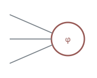

## 引言 {#intro}

这一段是本章的第一句话。激活函数 $\phi$ ==逐元素==作用，能不能融合进 GEMM 的 [epilogue](https://en.wikipedia.org/wiki/Matrix_multiplication)，要看 `act_fn` 的实现，以及 $z_i$ 的范围。**加粗**和*斜体*也要正常显示。

### 一个神经元收到的是什么 {toc="神经元的输入"}

上面的 FFN 公式对一个 token 的表示 $x \in \R^d$ 进行计算。第 $i$ 个神经元收到的数是

$$
z_i = x w_i + b_i \label{eq:pre}
$$

其中 $w_i$ 是 $W_1$ 的第 $i$ 列。由式 \eqref{eq:pre} 可知，激活函数只看 $z_i$ 这一个数[^gemm]。这一层的开销直接决定整个模型的开销[^cost]。^neuron-input

- ==$f(0)$ 是多少==：输入为零时是否输出零。
- ==导数在原点是否连续==：不连续意味着梯度跳变。求导可以按项拆开：$\dfrac{d}{dx}\big(f(x) + g(x)\big) = \dfrac{d}{dx}f(x) + \dfrac{d}{dx}g(x)$。

1. 有序列表的第一项。
2. 有序列表的第二项，带一个旁注[^list]。

:::recap
每个神经元只看自己的预激活值 $z_i$，激活函数逐元素作用：$\mathrm{FFN}(x) = \phi(x W_1 + b_1)\, W_2 + b_2,\ W_1 \in \mathbb{R}^{d \times d_{ff}}$。

$$
\frac{\partial L}{\partial W_1} = x^\top \left( \frac{\partial L}{\partial h} \odot \phi'(x W_1 + b_1) \right) \in \mathbb{R}^{d \times d_{ff}}
$$
:::

### 读图的四个要素

> We find that some of these variants yield quality improvements over the typically-used ReLU or GELU activations.
>
> — Shazeer, *GLU Variants Improve Transformer*, 2020

:::aside{title="阅读约定"}
本文的 $\sigma(x)$ 表示 logistic sigmoid，$\Phi(x)$ 表示标准正态分布的累积分布函数，$\odot$ 表示逐元素乘。
:::

:::fold{title="推导：GELU 的导数"}
对 $x\Phi(x)$ 用乘积法则，得到

$$
\frac{d}{dx}\, x\Phi(x) = \Phi(x) + x\varphi(x) \label{eq:gelu-grad}
$$

这一步只用到乘积法则。
:::

:::fold{title="展开了解：为什么期望恰好是 $x\Phi(x)$？"}
标题里的公式在构建时排版。


:::

门控形式能在同参数量下压低 loss [@shazeer2020]。GELU 的定义见 [@gelu]，两者一起见 [@shazeer2020; @gelu]。

:::recap
引用、提示框和折叠块的写法；折叠块默认收起。
:::

## 复杂块

本章检查公式、代码、表格、图片和交互组件的宽度规则。

### 公式与代码

$$
\mathrm{FFN}(x) = \phi(xW_1 + b_1)\,W_2 + b_2 \label{eq:ffn}
$$

由式 \eqref{eq:ffn} 可知，FFN 有两个矩阵。行内写法 $\eqref{eq:ffn}$ 也生成链接。下面这个长公式应该扩展到 wide：

$$
\operatorname{softmax}(z)_i = \frac{e^{z_i}}{\sum_{j=1}^{n} e^{z_j}} = \frac{1}{1 + \sum_{j \ne i} e^{z_j - z_i}} = \frac{1}{1 + e^{z_1 - z_i} + e^{z_2 - z_i} + e^{z_3 - z_i} + e^{z_4 - z_i} + \cdots + e^{z_{n-1} - z_i} + e^{z_n - z_i}} \quad \text{对所有 } i = 1, \dots, n
$$

```python
def swiglu(x, w_gate, w_up, w_down):
    return (F.silu(x @ w_gate) * (x @ w_up)) @ w_down  # 一次 GEMM 后在 epilogue 里做逐元素乘，这一行很长，应该扩展到 wide 然后滚动
```

```js
const short = 1
```

### 表格

| 模型 | 激活函数 | 上界 | $d_{ff} / d$ | 参数量 | 发布 |
|---|---|---|---:|---:|---|
| Llama 3 8B | SwiGLU | 无 | 3.5 | 8B | 2024-04 |
| gpt-oss-120b | SwiGLU + clamp | ±7 | — | 117B | 2025-08 |
| Nemotron | Squared ReLU | 无 | — | — | — |

| 范数 | 定义 |
|---|---|
| L1 | $|x|_1 = \sum_i |x_i|$ |
| L2 | $\norm{x}_2$ |

:::list-table
* - 激活函数
  - 公式
  - 特点
  - 曲线
* - ReLU
  - $\max(0, x)$
  - - 计算只需要一次比较
    - 负半轴梯度为 0
  - {width=64px}
* - GELU
  - $x\Phi(x)$
  - 在 0 附近平滑。

    见[链式法则](/2026-07/matrix-fixture/#chain-rule)。
  - {width=64px}
:::

:::{width=page}
| 宽度 | 说明 | 第三列 | 第四列 | 第五列 | 第六列 | 第七列 | 第八列 |
|---|---|---|---|---|---|---|---|
| page | 这张表格明确写了 page，目录在它可见时淡出 | 内容 | 内容 | 内容 | 内容 | 内容 | 内容 |
:::

### 图片


{width=160px float=left}

一个神经元把每个输入乘以对应的权重，求和后加上偏置，再经过激活函数得到输出。多个神经元并排组成一层，多层依次连接组成网络。这段文字比较长，用来检查文字环绕在浮动图片的右边，并且图片顶端和这一段的第一行对齐。

{width=120px float=right}

第二张浮动图片靠右，它从前面所有浮动图片的下方开始。这里的文字环绕在左边。

### 交互组件

:::fixture-curve{fn=tanh range=6 title="曲线标题"}
实线是 $\tanh$。拖动「缩放」查看差异。
:::

:::fixture-curve{fn=relu width=body height=220 dashed}
:::

:::fixture-curve{fn=tanh width=300px}
窄组件的框宽 300px，在正文栏里居中。
:::

:::fixture-curve{fn=relu width=50%}
:::

:::fixture-grid{cells=24}
不画边框的组件，只保留宽度和图注。
:::

## 没有小节的章 {#no-sections}

这一章没有 ### 小节，读到这里时目录把这一章本身标为当前位置。

## 跨文章

SwiGLU 的反向传播同样遵循[链式法则](/2026-07/matrix-fixture/#chain-rule)，门控的梯度按[这一段](/2026-07/matrix-fixture/#local-grad)的方法计算。整篇文章见[矩阵求导](/2026-07/matrix-fixture/)。回到本文的[引言](#intro)。

### 嵌入

反向传播的每一步都用到链式法则，推导见下面两处：

:::embed
/2026-07/matrix-fixture/#local-grad
/2026-07/matrix-fixture/#vjp
:::

有了这条规则，就可以从输出层逐层往回算。

:::embed
/2026-07/matrix-fixture/#notation
:::

---

:::references
- [@shazeer2020] Shazeer. *GLU Variants Improve Transformer*. 2020.
- [@gelu] Hendrycks, Gimpel. *Gaussian Error Linear Units*. 2016.
:::

[^gemm]: epilogue 是矩阵乘法内核里对结果逐元素处理的阶段。在这里做激活，结果不需要写回显存再读一次。
[^cost]: 两种做法：clamp 直接截断，soft-capping 用 $c \cdot \tanh(x/c)$ 平滑地限制在 $\pm c$ 之内。
[^list]: 列表项里的旁注。
